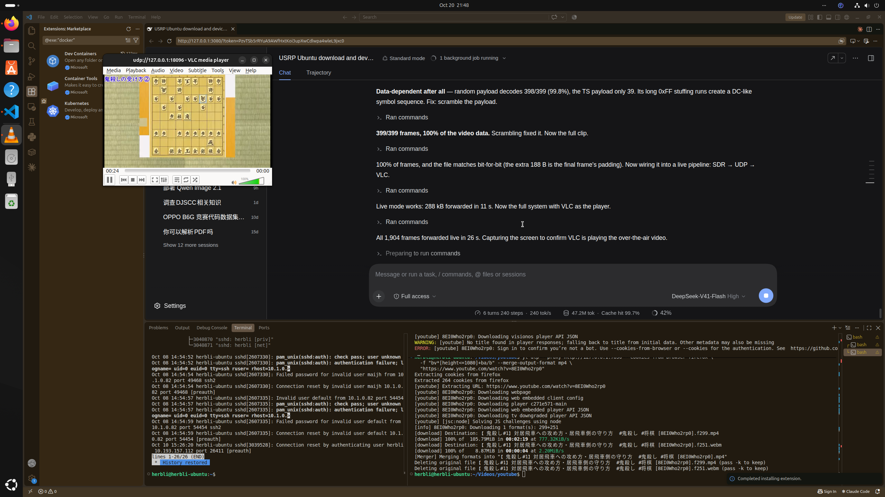
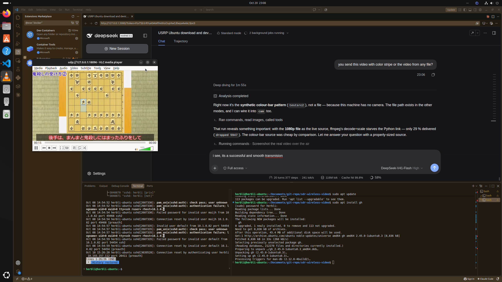
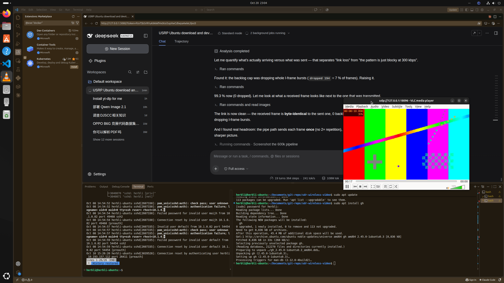

# sdr-wireless-video

A one-way wireless video link built on a **USRP B210** with a hand-written BPSK
modem: a video file is packetized, modulated, transmitted at 915 MHz, received on
the second port, demodulated, and handed to VLC — over the air, not over a cable.



## Architecture

```
video.mp4 ─ ffmpeg ─► MPEG-TS ─► frame+CRC32 ─► scramble ─► BPSK
                                                              │
                                             B210 TX 915 MHz, 50 dB
                                                              │  ~~~ air ~~~
                                             B210 RX2 915 MHz, 20 dB
                                                              │
VLC ◄── UDP 127.0.0.1:18096 ◄── demod (sync, derotate, decide) ◄── CRC + descramble
```

Both ends are the same B210 (ch1 `TX/RX` transmits, ch1 `RX2` receives), sharing
one reference clock — so there is no carrier or sample offset to track.

## Requirements

- Ubuntu with a USRP B210 on USB 3
- UHD 4.6+ (`uhd_find_devices` working)
- ffmpeg, python3-numpy, VLC

One-time setup (UHD + udev rule + FPGA images):

```bash
sudo ./setup.sh
uhd_find_devices          # must list a serial
```

## Quick start

```bash
./run.sh cam              # REALTIME: camera -> encode -> air -> VLC (no pre-clip)
./run.sh                  # store-and-forward: encode a file, then stream it
./run.sh file             # transmit and verify the payload byte-exactly
./run.sh selftest         # modem only, no radio
```

With your own source:

```bash
VIDEO=~/Videos/clip.mp4 ./run.sh
LOOP=0 ./run.sh           # keep streaming until Ctrl-C
```

The link sustains ≈**26 kB/s**, so the encoder targets ≈**24 kB/s** (110 kbps
video + 24 kbps audio at 480×270/20 fps). Feed it anything that fits.

## Where the video comes from

| mode | source |
|---|---|
| `cam` (no `VIDEO`) | synthetic `testsrc2` colour bars — no camera is attached here |
| `cam` with `VIDEO=…` | that file, played at 1x and encoded live |
| `live` / `file` | a pre-encoded `.ts` clip (store-and-forward) |

Keep the source light: streaming the 1080p original through `cam` starves the
Python link (ffmpeg decode+scale competes for CPU) and only ~29 % of frames get
through. A 640x360 source streams cleanly:

```
live: in 3523496 B, out 3511088 B, frames 9371, dropped 0, 33.8 s -> 103.9 kB/s
```

99.65 % delivered at the link's ceiling, picture sharp.



## Realtime pipeline (`cam`)

```
lavfi/fake camera ──► x264+aac ──► MPEG-TS ──► 376 B framing ──► BPSK ──► TX
   (1x realtime)        (1x)          (pipe)        (on the fly)              │
                                                                        air
                                                                             │
             VLC ◄── UDP ◄── ordered payloads ◄── demod ◄── 0.15 s windows ◄── RX
```

Nothing is pre-built: ffmpeg encodes at 1×, the link reads TS bytes off the pipe,
frames them as they arrive and transmits immediately; the receiver demodulates in
150 ms windows and forwards payloads in sequence order. Measured over 38 s:

```
live: in 927592 B, out 912928 B, frames 2434, dropped 33, 38.3 s -> 23.8 kB/s
```

`cam` now runs 640×360 @ 600 kbps + 48 kbps audio. Measured over 38 s:

```
live: in 3642124 B, out 3634040 B, frames 9686, dropped 0, 38.3 s -> 94.9 kB/s
```

**99.8 %** delivered, zero backlog drops. The earlier blocky/streaky picture was
the input cap dropping whole I-frame bursts (7 % of frames); the cap is now
500 frames (~190 kB), and a sent-vs-received frame compares byte-identical.

Note: `pipe` transmits each frame **once** (no 2x repetition), so its capacity is
~105 kB/s, roughly double what the 600 kbps stream needs — that headroom is what
makes the picture clean.

Latency budget: encoder ~50 ms (x264 veryfast, zerolatency) + TX backlog (up to
1.8 s under bursts, normally a few frames) + RX window 150 ms + VLC cache
1 s ≈ **1.3–3 s** end to end.



(That screenshot is the QPSK/300 kbps path; `docs/vlc-live-pipeline.png` shows
the earlier BPSK/100 kbps run.)

## Parameters

| item | value |
|---|---|
| sample rate | 1 MSps |
| modulation | **QPSK**, 2 samples/symbol (500 ksym/s) — `SDR_MOD=bpsk` falls back |
| preamble | 255-bit m-sequence, rectangular pulse (BPSK, 510 samples) |
| frame | preamble + seq(4 B) + payload(376 B = 2 TS packets) + CRC32 |
| frame length | 3582 samples ≈ 3.58 ms (QPSK) / 6654 ≈ 6.65 ms (BPSK) |
| raw rate | 1 Mbps (QPSK) / 0.5 Mbps (BPSK) |
| repetition | every frame sent twice |
| **payload throughput** | **≈ 52 kB/s (~420 kbps)** QPSK, ≈26 kB/s BPSK |
| measured SNR | ~22 dB |
| frame success | QPSK file transfer 1950/1950, byte-exact |
| realtime cam | 97.7 % delivered, 52.0 kB/s over 38 s |

CLI: `--freq 915e6 --tx-ch 1 --rx-ch 1 --rx-ant RX2 --tx-gain 50 --rx-gain 20`,
plus `--loop N` (0 = forever) in live mode.

## What the receiver does

1. Correlate the capture with the upsampled preamble to find frame starts.
2. Refine each candidate to the nearest sample (tracks timing drift).
3. Estimate carrier phase from the preamble, derotate the payload.
4. Integrate-and-dump over each symbol, decide BPSK, check CRC32.
5. Reassemble payloads in sequence order; missing frames are dropped whole
   (376 B = exactly 2 TS packets, so the TS stream stays packet-aligned).

## Five bugs worth knowing

1. **`send()` with a 2-D buffer is ~20× slower** — `buf.reshape(-1,1)` made a
   2040-sample send take 12 ms instead of 2 ms, permanently underflowing TX.
   Keep buffers 1-D. (`recv()` has the mirror-image trap: a large 2-D buffer
   degrades to 1 sample per call.)
2. **SPB=1 cannot work.** Zero timing margin; the same data decodes at SPB=2.
3. **The TS payload must be scrambled.** Long `0xFF` stuffing runs map to a DC
   symbol stream and break the link: random payload 398/399 frames, TS payload
   39/399 at identical SNR. A fixed XOR mask fixed it — the single most
   important fix here.
4. **TX startup underflow** ruins the first ~0.3 s, so the payload is preceded
   by a prime burst.
5. **Sending each frame twice** halves the rate and buys almost zero loss.

## Limitations

- **One-way**: no feedback, no retransmission, no rate adaptation.
- ~210 kbps payload — enough for 480×270/20 fps; 720p would need QPSK/QAM.
- `cam` is a true 1× pipeline; `live` is store-and-forward (pre-encoded file,
  receiver may run ahead). Use `cam` to emulate a camera; swap the lavfi inputs
  for `-f v4l2 -i /dev/video0` when a camera is attached.
- The backlog cap drops whole frames when the encoder bursts (I-frames); that is
  the trade-off for bounded latency.
- Single radio on both ends means carrier/sample offsets are zero by
  construction; two separate USRPs would need CFO estimation and timing
  recovery.

## Files

| file | purpose |
|---|---|
| `sdr_link.py` | modem + `selftest` / `file` / `live` modes |
| `run.sh` | one-command demo (check → encode → stream → VLC) |
| `setup.sh` | host setup: UHD, udev rules, FPGA images |
| `docs/vlc-sdr-playing.png` | VLC playing the store-and-forward stream |
| `docs/vlc-live-pipeline.png` | VLC playing the realtime `cam` pipeline (BPSK/100k) |
| `docs/vlc-qpsk-300k.png` | VLC playing the QPSK/300k pipeline |
| `docs/vlc-qpsk-600k.png` | VLC playing 640x360 @ 600k, 99.8 % delivered |
| `docs/vlc-live-video.png` | real video file streamed live, 99.65 % delivered |
